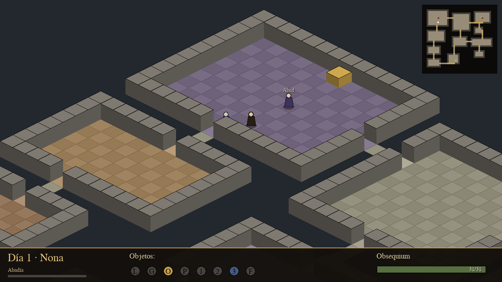
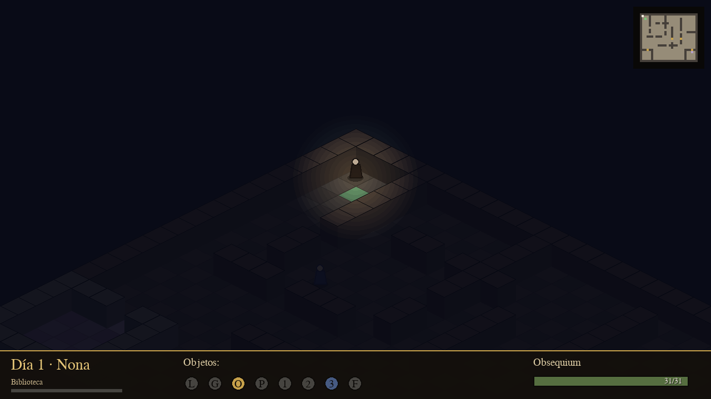

# 🕯️ La Abadía del Crimen — Edición 2026

Remake moderno y **fiel** en **Python + pygame** del clásico de **Paco
Menéndez / Opera Soft** (1987), inspirado en *El nombre de la rosa* de **Umberto
Eco**. Reconstruido a partir de la ingeniería inversa del original (desensamblado
de Manuel Abadía y los ports de [ibaca](https://github.com/ibaca/la-abadia-del-crimen)
y [ultrabolido](https://github.com/ultrabolido/abadia)).

Motor **isométrico** propio, **3 plantas** (abadía, scriptorium y
biblioteca-laberinto), los **8 personajes** reales con IA por horarios, los **8
objetos** con función, mecánica de **obsequium**, las **7 horas canónicas**, el
**guion de los 7 días** con sus crímenes, el **enigma del espejo** y los
**diálogos reales en español**. Un único ejecutable: `abadia.py`.



## 🚀 Cómo jugar

```bash
pip install -r requirements.txt
python3 abadia.py
```

Requiere **Python 3.10+**. (`numpy` es opcional: activa las campanas.)

## 🎮 Controles

| Acción | Tecla |
|---|---|
| Mover a Guillermo | Flechas o `W A S D` |
| Controlar a Adso | mantén `CTRL` + mover |
| Acción (hablar / subir escaleras / espejo) | `E` |
| Pausa | `ESC` / `P` |
| Guardar | `F5` |
| Menú | Flechas + `Enter` |

Los objetos se recogen al pasar por encima.

## 🎯 Objetivo

Eres **Fray Guillermo de Occam**; **Adso** te acompaña. Durante **siete días**:

1. Mantén tu **obsequium** (0–31): acude a los oficios (Prima, Vísperas), a la
   comida (Sexta) y duerme en tu celda (Completas, Noche). Cada falta resta 2;
   si baja de 0, el Abad te expulsa.
2. Reúne **guantes**, **gafas** y el **pergamino** de Venancio, y sube por las
   escaleras al **scriptorium** y a la **biblioteca** (necesitas la **lámpara**
   de Adso para no perderte en la oscuridad).
3. Resuelve el **enigma del espejo** y llega ante **Jorge de Burgos** el 6.º/7.º
   día. Con los **guantes** sobrevivirás al **libro envenenado** (el *Coena
   Cipriani* de Aristóteles) y resolverás el misterio.

## 📂 Estructura

```
abadia.py              → lanzador
juego/
  config.py            → constantes canónicas (horas, objetos, obsequium)
  iso.py               → proyección isométrica
  mapa.py              → 3 plantas + escaleras
  pathfinding.py       → A* para la IA
  personajes.py        → Guillermo, Adso y los 6 monjes con IA por horarios
  objetos.py           → los 8 objetos
  tiempo.py            → reloj de días y horas canónicas
  frases.py            → diálogos reales en español + intro/final
  guion.py             → eventos programados de los 7 días
  hud.py               → interfaz (obsequium, reloj, inventario, minimapa)
  audio.py             → campanas procedurales (opcional)
  juego.py             → núcleo: bucle, estados, render, reglas
```

## 📖 Documentación

- **[`ABADIA_DISENO.md`](ABADIA_DISENO.md)** — diseño, motor y guía de desarrollo.
- **[`COMPARATIVA_Y_MEJORAS.md`](COMPARATIVA_Y_MEJORAS.md)** — fuentes estudiadas,
  comparativa con el original y plan de mejora aplicado.

## 🌙 Capturas

| Abadía (planta baja) | Biblioteca-laberinto (a oscuras) |
|---|---|
|  |  |

---

*Homenaje educativo y no comercial. Todos los derechos de la obra original
pertenecen a sus autores: Paco Menéndez, Juan Delcán y Opera Soft. La
reconstrucción se basa en la ingeniería inversa de Manuel Abadía y no incluye
datos binarios propiedad de Opera Soft.*
