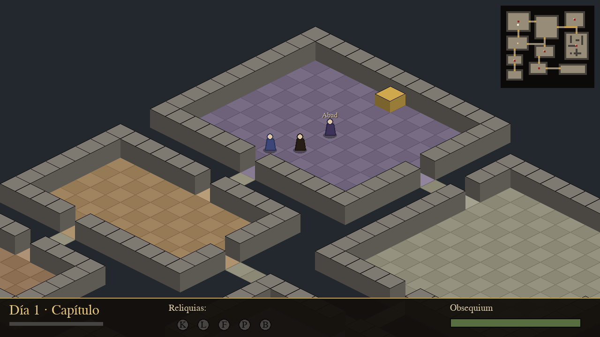
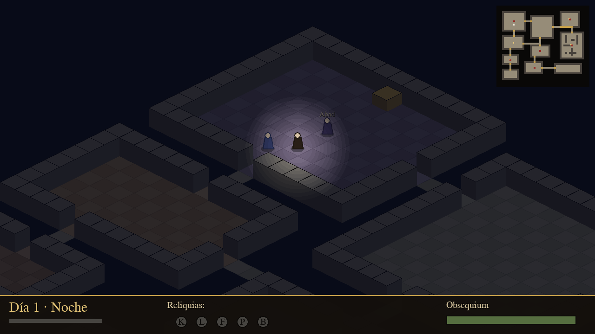

# 🕯️ La Abadía del Crimen — Edición 2026

Remake moderno en **Python + pygame** del clásico de **Paco Menéndez / Opera
Soft** (1987), inspirado en *El nombre de la rosa* de **Umberto Eco**.

Motor **isométrico** propio, IA de monjes, ciclo **día/noche** con iluminación
dinámica, mecánica de **obsequium**, horario de **horas canónicas**, inventario,
**minimapa** y guardado. Un único ejecutable: `abadia.py`.



## 🚀 Cómo jugar

```bash
# 1) Instala la dependencia
pip install -r requirements.txt

# 2) Arranca el juego
python3 abadia.py
```

Requiere **Python 3.10+**.

## 🎮 Controles

| Acción | Tecla |
|---|---|
| Mover a Guillermo | Flechas o `W A S D` |
| Controlar a Adso | mantén `CTRL` + mover |
| Hablar / examinar | `E` |
| Pausa | `ESC` / `P` |
| Guardar partida | `F5` |
| Navegar el menú | Flechas + `Enter` |

## 🎯 Objetivo

Encarnas a **Fray Guillermo de Occam**, acompañado de tu novicio **Adso**.
Durante siete días debes:

1. Cumplir la disciplina monástica (acudir a los oficios, no deambular de
   noche) para mantener alto tu **obsequium**. Si llega a cero, el Abad te
   expulsa.
2. Reunir las **cuatro reliquias** (llave, lentes, lámpara y pergamino)
   repartidas por la abadía.
3. Entrar en la **biblioteca prohibida** y hallar el **libro** que resuelve el
   crimen, antes de que acabe el séptimo día.

## 📂 Estructura

```
abadia.py            → lanzador (punto de entrada)
juego/               → paquete del juego (motor, mapa, IA, HUD, reglas)
ABADIA_DISENO.md     → documento de diseño y guía de desarrollo completa
requirements.txt     → dependencias
```

## 📖 Documentación

El diseño completo, la matemática isométrica, el análisis del original y la
guía paso a paso están en **[`ABADIA_DISENO.md`](ABADIA_DISENO.md)**.

## 🌙 Capturas

| Día | Noche (iluminación dinámica) |
|---|---|
|  |  |

---

*Homenaje educativo y no comercial. Todos los derechos de la obra original
pertenecen a sus autores: Paco Menéndez, Juan Delcán y Opera Soft.*
